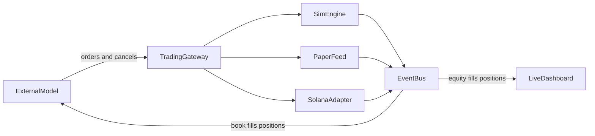

# Solana Model Trading Platform

This is a greenfield DubHacks build. We build the market, the API a model trains and executes against, and the page a person uses to watch the account. We do not build a model, a policy, a trainer, or a sample strategy.

## What “HFT” can mean here

Solana produces a slot about every 400ms. A competitive on-chain bot is a low-latency agent (tens of milliseconds), not a TradFi microsecond strategy. The API is therefore a numeric order interface with a tight observation payload. It is not a chat endpoint.

Training also cannot be “send a Solana transaction per step.” Millions of steps need an in-memory book. Solana is the execution venue and the realism check, not the training clock.

Three modes, one order language:

- **Sim** — in-memory book, accelerated time, synthetic counterparties. An external trainer calls this.
- **Paper** — same book and fill rules, but the mid and external trades come from live Solana data. The dashboard shows this.
- **Chain** — the same order intent becomes a Solana transaction on Surfpool, then devnet. Mainnet is out of scope for the hackathon.



The external model and the browser never share a socket. The gateway is the only writer. The dashboard is read-only except for the kill switch.

## 1. Simulated market

Build a continuous double auction that copies Phoenix’s FIFO rule: best price first, then time at that price. Phoenix is the on-chain CLOB whose matching is atomic inside one Solana transaction (program `PhoeNiXZ8ByJGLkxNfZRnkUfjvmuYqLR89jjFHGqdXY`). Matching that rule locally means a sim fill and a later Phoenix order mean the same thing.

**Book**

- One market for the demo: SOL/USDC.
- Integer prices and sizes (tick and lot). No floats in the matcher.
- Price-time priority using a map of price levels plus a FIFO queue per level.
- Order types a client may send: limit, market, post-only, IOC, cancel, cancel-all.
- Partial fills. A remainder rests, expires, or dies according to time-in-force.
- Maker/taker fees in basis points, close to Phoenix so a trainer does not learn a free market.
- Self-trade prevention: a client’s resting order is canceled or skipped, never traded against itself.

**Clock**

- The engine is event-driven, not wall-clock. A trainer calls `step()` and the book jumps forward.
- Every order is delayed by a configured latency (start at 50ms of sim time) so a client cannot fill against a book it has already seen change.
- Paper and dashboard mode run the same engine against a 100–250ms wall-clock tick so the UI looks live even when no external model is connected. Counterparty agents keep the book moving.

**Counterparties, so the book is not empty**

These are market infrastructure, not a tradable policy. They exist so the book has two sides during training and during the demo.

- Noise traders that cross the spread at random.
- A market maker that quotes a spread around the mid (a small Avellaneda-Stoikov-style quote is enough).
- A momentum agent that lifts or hits when the mid trends.
- An exogenous mid: geometric Brownian motion in pure sim, or a recorded SOL/USDC path in replay.

Replay is the second sim mode. Record mid, trades, and top-of-book from a paper session, then play that tape back instantly for an external trainer. Do not try to replay full Solana history inside the SVM for the learning loop.

**Observation the API returns**

- Top 10 bid and ask levels (price and size).
- Last trade price and side.
- The connected account’s position, free USDC, open orders, unrealized and realized PnL.
- A short window of recent mids.
- On `step()`, a reward equal to the change in mark-to-market minus fees, plus a done flag. The trainer is external. We only return the number.

**Order a client may submit:** side, price, size, and time-in-force, keyed by `client_order_id`. The gateway rejects anything outside risk limits before it hits the book.

**Risk, applied in every mode**

- Max position, max order size, max loss from the session start, max orders per second.
- A kill switch flattens and pulls all orders for the account. The dashboard button and a gateway admin call both hit it.

## 2. How Solana hooks in

An external model never builds a transaction and never holds a user key. It sends an `OrderIntent`. The gateway’s execution port either matches it locally or hands it to the Solana adapter.

**Internal intent (all modes)**

- `client_order_id`, market, side, price, size, type, time-in-force.
- Idempotent on `client_order_id` so a retry cannot double-send.

**Chain adapter, in this order**

1. **Surfpool (hackathon chain).** Local Solana RPC on `localhost:8899`, sub-second startup, lazy clone of mainnet accounts. Use it to prove the adapter builds a real transaction against real program accounts. Surfpool scenarios can move Pyth, Raydium, Whirlpool, and Drift account state without a mock DEX. That is the chain-level test harness, not the training engine.
2. **Paper feed (demo).** Subscribe to a live SOL price (Pyth via an RPC provider, or Phoenix’s market WebSocket if the API is reachable). Publish that mid into the sim engine as an external trade/quote. Fills stay internal. The user watches a live-feeling book with no mainnet risk.
3. **Devnet execution (stretch).** For one aggressive order, swap a small devnet SOL/USDC size through Jupiter’s quote-and-swap API, or place a limit on a devnet Phoenix market if one is liquid enough. Confirm on the adapter, then emit a fill event in the same shape as a sim fill.

**Why two venue types**

- Resting limits map to Phoenix: place, cancel, and the on-chain FIFO book.
- Marketable orders that just need a fill map to Jupiter: quote, then a versioned transaction. Jupiter is the aggregator over Raydium, Orca/Whirlpool, Meteora, and others. Use it when the goal is “get filled,” not “join the queue.”

**Account model**

- Sim and paper: an internal ledger. The session starts with a virtual USDC balance.
- Chain: the user connects a wallet and signs once to delegate a session key with a spend ceiling. The adapter signs orders with that session key. A kill switch revokes it.
- Positions in the UI always come from gateway events. On chain mode, a balance read is only a reconciliation check, not the frame-by-frame source.

**What we will not build this weekend**

- A model, policy, trainer, or reference strategy.
- Jito bundles, ShredStream, and a private RPC. Those are how real Solana bots compete, and they are irrelevant until there is mainnet capital.
- A custom on-chain matching program. Phoenix already is that program. Reimplementing it burns the hackathon.
- Mainnet trading.

## 3. The API an external model uses

One process exposes two faces of the same gateway. Both speak the same events: `Book`, `Trade`, `OrderAck`, `Fill`, `Position`, `Account`.

- **Streaming API** for paper and chain execution: WebSocket at `/v1/stream`, plus REST for snapshots.
- **Step API** for training: `reset()` and `step()` over REST, or an in-process call, so an external trainer is not stuck on the wall clock. `step()` advances the sim, applies any orders in the request, and returns the next observation, reward, and done flag.

**Streaming messages**

- Client to gateway: `place`, `cancel`, `cancel_all`, `flatten`.
- Gateway to client: `ack`, `reject`, `fill`, `book`, `account`.
- Every order carries `client_order_id`. Acks echo it.

Publish the request and response shapes as a short JSON schema next to the gateway so an outside model can bind to them. That schema is the contract. There is no client policy and no training loop in this repo.

The account stays flat until an external client sends orders. Counterparty flow still prints on the book and on the dashboard.

## 4. How a user watches live

The event bus fans fills, positions, and equity out to a dashboard channel. The page does not place orders. The only write it can make is the kill switch.

**Screen**

- Mode badge: Sim, Paper, or Chain.
- Equity curve from session start, marked each tick at mid.
- Position in SOL, cash in USDC, realized and unrealized PnL.
- Open orders and a scrolling fill tape.
- A depth chart or top-of-book ladder.
- Kill switch.

**Transport**

- Browser connects to `/v1/watch` (WebSocket). Server pushes an `Account` snapshot about 4 times a second and a fill immediately when one happens.
- On connect, send a full snapshot, then deltas. If the socket drops, the client reloads the snapshot.
- Keep this fan-out off `/v1/stream` so a slow browser cannot stall order entry.

[frontend/index.html](frontend/index.html) becomes this single-page view. No account system. One local session.

## Process layout

```text
engine/          # book, counterparty agents, latency, risk
gateway/         # REST step API, /v1/stream, /v1/watch, JSON schema
solana/          # paper price feed + Surfpool tx adapter
frontend/        # read-only live portfolio page
```

Python is the right hackathon runtime for the book and the gateway. Surfpool is an external process the adapter talks to over JSON-RPC only in chain mode.

**Demo script**

1. Start the gateway in paper mode. The book moves from the live SOL mid and the counterparty agents. The account is flat.
2. Open the dashboard and show the book, the mid, and a flat equity line.
3. Send a handful of order requests from an external caller (curl or any outside client) and show the position, fills, and equity update on the page.
4. Hit kill switch and show orders pulled and the position flattened.
5. Call `reset()` and `step()` in sim mode and show the same observation and fill shapes coming back faster than wall clock.
6. If time: Surfpool clones a mainnet account and the adapter simulates one Jupiter or Phoenix transaction, then the dashboard shows that fill.

## Limits to say out loud in the demo

- Paper fills are our match against a live mid, not a guarantee of mainnet fill.
- Solana cannot host a microsecond strategy. The sim’s 50ms delay is the stand-in for slot time and network delay.
- Chain mode on Surfpool proves transaction construction. It does not prove priority-fee or leader-schedule performance.
